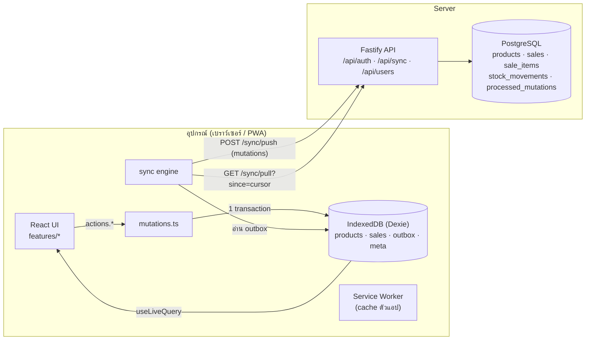
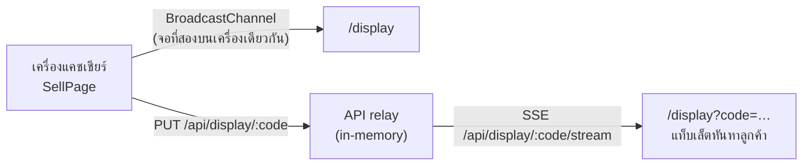

# สถาปัตยกรรม หน้าร้าน POS

## เป้าหมาย
1. **ใช้ได้ทุกอุปกรณ์**: มือถือ แท็บเล็ต คอม ผ่านเบราว์เซอร์ และติดตั้งเป็นแอปได้ (PWA)
2. **ขายได้แม้เน็ตหลุด**: บันทึกในเครื่องก่อนเสมอ แล้วซิงก์ตามหลัง
3. **ข้อมูลตรงกันทุกเครื่อง**: หลายเครื่องขายพร้อมกัน สต็อกต้องไม่เพี้ยน
4. **ตรวจสอบย้อนหลังได้**: ทุกการเปลี่ยนสต็อกมีประวัติ ไม่มีการเขียนทับเงียบๆ

## ภาพรวม



## โครงสร้างโปรเจกต์

```
packages/shared     โค้ดที่ใช้ร่วมกันทั้งสองฝั่ง
  money.ts          เงินเป็นสตางค์ (int) ทั้งระบบ
  schemas.ts        Product, Sale, ShopSettings (zod)
  sync.ts           โปรโตคอล push/pull, ชนิด mutation, สิทธิ์ต่อ mutation, การคำนวณยอดบิล
apps/api            Fastify + Drizzle ORM
  db/schema.ts      ตาราง + sequence change_seq
  db/client.ts      Postgres (prod) หรือ PGlite (dev/test) + migration อัตโนมัติ
  modules/auth      login (JWT 30 วัน), middleware ตรวจสิทธิ์
  modules/sync      apply.ts (รับ mutation), pull.ts (ส่งการเปลี่ยนแปลง)
  modules/users     เจ้าของร้านเพิ่มบัญชีแคชเชียร์
apps/web            React + Vite + PWA
  lib/db.ts         IndexedDB schema
  lib/mutations.ts  ทุกการกระทำของผู้ใช้ (optimistic + outbox)
  lib/sync/engine   push → pull, retry, สถานะการซิงก์
  lib/hooks.ts      live queries ที่หน้าจอใช้
  features/         sell · inventory · reports · settings · auth
```

## หลักการออกแบบ

### 1. Offline-first: หน้าจออ่านจาก IndexedDB เท่านั้น
หน้าจอไม่เคยรอ API กดขายเสร็จแล้ว `actions.createSale()` เขียนบิลลงเครื่องและต่อคิว outbox
ภายใน transaction เดียว จากนั้นแสดงใบเสร็จทันที sync engine ส่งขึ้น server ตามหลัง

### 2. ส่ง "เจตนา" ไม่ใช่ "ค่าสุดท้าย"
client ไม่ส่ง `stock = 38` แต่ส่ง `sale.create` ที่มีรายการ `กาแฟ × 2`
server แปลงเป็นแถวใน **stock ledger** (`stock_movements.delta = -2`) แล้วอัปเดตยอดแคช `products.stock`
ใน transaction เดียวกัน ผลคือถ้าสองเครื่องขายตอนออฟไลน์แล้วซิงก์ทีหลัง ยอดยังถูกต้อง (มี test ยืนยัน)

| mutation          | สิทธิ์      | ผลที่ server |
|-------------------|------------|--------------|
| `sale.create`     | แคชเชียร์   | บันทึกบิล + movement `sale` ต่อรายการ |
| `stock.adjust`    | แคชเชียร์   | movement `receive` / `waste` / `adjust` |
| `sale.void`       | เจ้าของ     | สถานะ voided + movement `void` คืนสต็อก |
| `product.upsert`  | เจ้าของ     | สร้าง/แก้สินค้า (ไม่แตะสต็อก) |
| `product.archive` | เจ้าของ     | ซ่อนสินค้า (ไม่ลบจริง บิลเก่ายังอ้างถึงได้) |
| `settings.update` | เจ้าของ     | ข้อมูลร้านบนใบเสร็จ |

### 3. Idempotent push
ทุก mutation มี `mid` (UUID) ที่ client สร้าง server จดไว้ใน `processed_mutations`
ถ้าเน็ตหลุดตอนรอคำตอบแล้ว client ส่งซ้ำ จะได้ `duplicate` และไม่หักสต็อกซ้ำ
mutation ที่ผิดกฎทางธุรกิจได้ `rejected` (ถาวร) client ย้ายไปแสดงในหน้าตั้งค่า ไม่ retry วนไม่จบ

### 4. Incremental pull ด้วย sequence เดียว
ทุกแถวที่ซิงก์มีคอลัมน์ `seq` จาก sequence `change_seq` ซึ่งเพิ่มทุกครั้งที่แถวเปลี่ยน
client เก็บ cursor (seq ล่าสุด) และขอเฉพาะแถวที่ใหม่กว่า
การเขียนทุกครั้งถือ advisory lock เดียวกัน ทำให้ seq ถูก commit ตามลำดับ client จึงไม่มีทางข้ามแถว
(เพียงพอสำหรับร้านเดียวหลายเครื่อง ถ้าโตเป็นหลายสาขาให้เปลี่ยนเป็น lock ต่อสาขา)

### 5. สต็อกที่หน้าจอ = ค่าจาก server + ส่วนที่ค้างใน outbox
`useProducts()` ไม่เขียนทับ `product.stock` ในเครื่อง แต่คำนวณสดจาก outbox
เมื่อ server รับแล้ว รายการหายจาก outbox พร้อมกับค่าใหม่ที่ pull มา ตัวเลขจึงไม่กระโดดและไม่นับซ้ำ

### 6. บิลที่ขายแล้วต้องรับเสมอ
ถ้าสต็อกไม่พอเพราะอีกเครื่องขายไปก่อนตอนออฟไลน์ server ยังรับบิล และสต็อกติดลบ
เพราะลูกค้าได้ของไปแล้วจริง สต็อกติดลบคือสัญญาณให้ตรวจนับ ไม่ใช่เหตุให้บิลหาย

### 7. เงินเป็นสตางค์ ยอดคำนวณที่ server
`computeSaleTotals()` อยู่ใน shared ใช้ทั้งสองฝั่ง server คำนวณยอดใหม่จากรายการเสมอ ไม่เชื่อยอดที่ client ส่งมา
ราคาต่อชิ้นยึดตามที่ขายจริงบนเครื่อง (ราคา ณ เวลาขาย)

### 8. เลขที่บิลไม่ชนกันแม้ออฟไลน์
`<รหัสเครื่อง 4 ตัว>-<YYMMDD>-<ลำดับ>` เช่น `92D2-261012-001` สร้างในเครื่อง ไม่ต้องถาม server

### 9. จอลูกค้า + QR พร้อมเพย์

- เครื่องแคชเชียร์ส่ง **สถานะทั้งหมด** (idle / cart / pay / done) ทุกครั้งที่เปลี่ยน จอที่เพิ่งเปิดจึงแสดงถูกทันที
- จอลูกค้าไม่ต้องเข้าสู่ระบบ ใช้ **รหัสจับคู่** 8 ตัว (สุ่ม, เปลี่ยนได้ในหน้าตั้งค่า) เห็นได้แค่ตะกร้าปัจจุบัน
- relay อยู่ในหน่วยความจำ ไม่ใช่ข้อมูลบัญชี บิลจริงไปทาง `/sync` เสมอ ถ้ามี API หลาย instance ให้เปลี่ยนเป็น Redis pub/sub
- QR สร้างตามมาตรฐาน EMVCo / Thai QR (`packages/shared/src/promptpay.ts`) ใส่ยอดเงินในตัว ลูกค้าไม่ต้องพิมพ์ยอด
- ระบบ **ไม่ได้ยืนยันว่าเงินเข้าจริง** (ต้องเชื่อม API ธนาคาร/payment gateway) พนักงานต้องดูเงินเข้าในแอปธนาคารก่อนกด "ได้รับเงินแล้ว"

## ความปลอดภัย
- รหัสผ่าน bcrypt, JWT อายุ 30 วัน (เครื่องขายออฟไลน์ได้ตลอดอายุ token)
- สิทธิ์ตรวจที่ server ต่อ mutation (`MUTATION_ROLES`) หน้าจอซ่อนปุ่มเพื่อความสะดวกเท่านั้น
- การจัดการพนักงานต้องออนไลน์ ไม่ผ่าน outbox
- ออกจากระบบไม่ได้ถ้ายังมีรายการค้างส่ง (กันบิลหาย) และล้าง IndexedDB เมื่อออก

## งานถัดไปที่แนะนำ
- [x] QR พร้อมเพย์ตามยอด + จอลูกค้า
- [ ] ยืนยันเงินเข้าอัตโนมัติ (Slip verification API หรือ payment gateway เช่น Omise / 2C2P / GB Prime Pay)
- [ ] พิมพ์ใบเสร็จ (เครื่องพิมพ์ความร้อน 58/80 มม. ผ่าน WebUSB / Bluetooth หรือ print CSS)
- [ ] เครื่องใหม่: pull บิลย้อนหลังแค่ 90 วัน (ตอนนี้ pull ทั้งหมด)
- [ ] รายงานฝั่ง server (ช่วงยาว, export CSV) และหน้าประวัติ stock movement
- [ ] Rate limit หน้า login, refresh token / เพิกถอน token รายเครื่อง
- [ ] หลายสาขา: เพิ่ม `store_id` ทุกตาราง + lock ต่อสาขา
- [ ] E2E test (Playwright) โหมดออฟไลน์
